# LED grow panel
  
  
## Introduction  
  
The goal of this project was to learn how to design boards on an aluminum substrate while creating a functional LED panel for growing plants indoors without natural sunlight.  
  
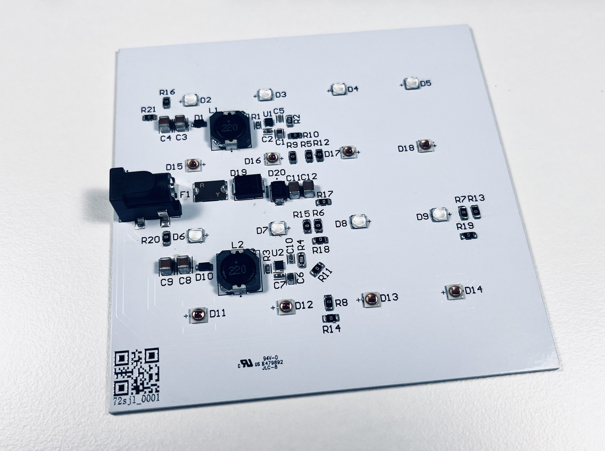  
  
  
## Design requirements  
  
• Aluminum substrate as a base  
• 12 VDC input  
• Basic surge protection for long‑run wires  
• 10 × 10 cm square PCB  
• LEDs rated for horticulture  
  
## Design  
  
The board was designed in Altium Designer, and the stack‑up and DRC rules were set to match JLCPCB’s manufacturing capabilities. A major challenge was that the design uses a single copper layer. Zero‑ohm jumpers were employed where necessary, but from an EMI standpoint keeping the ground return loops small proved difficult. I’m curious how this board will perform under radiation testing. Each LED requires a floating thermal pad; therefore, each one has its own small cooling pad that transfers heat to the aluminum substrate—a highly efficient arrangement thanks to the excellent thermal conductivity of the copper‑to‑aluminum interface.  
  
  
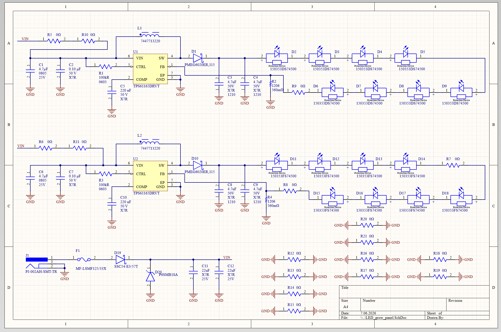  
  
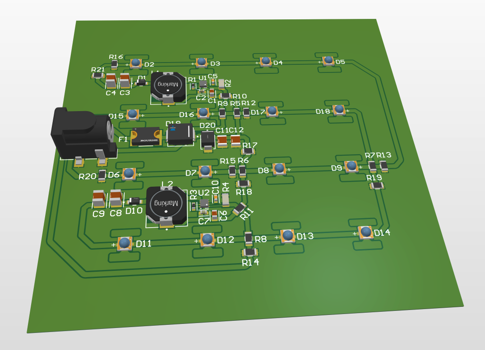  
  
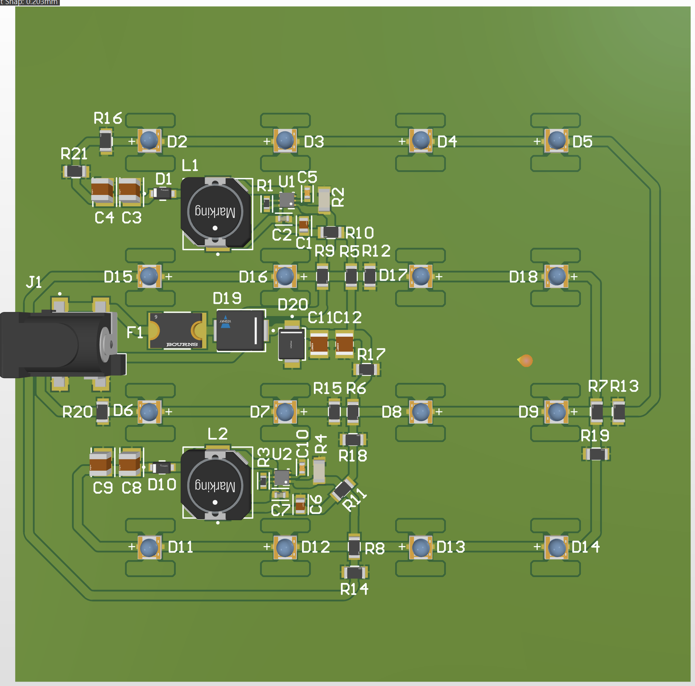  
  
  
## Board order  
  
Boards ordered on JLCPCB, all parameters set as below:  
  
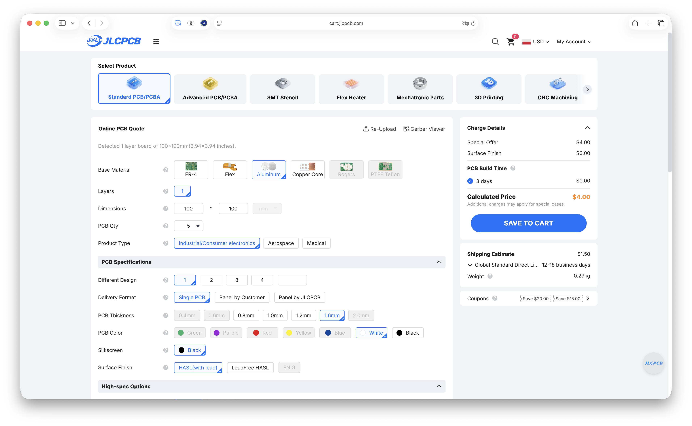  
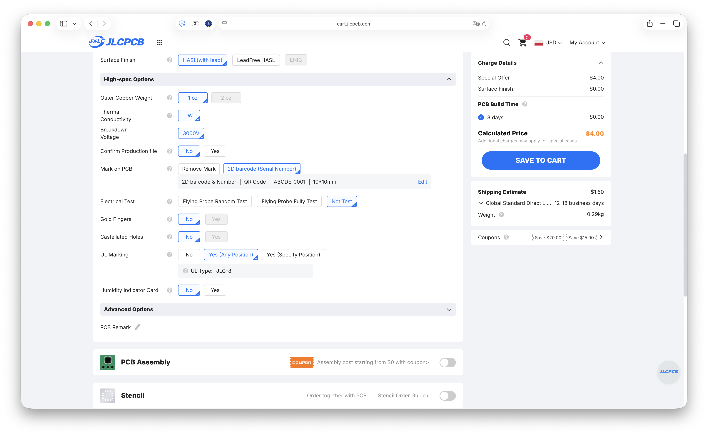  
  
  
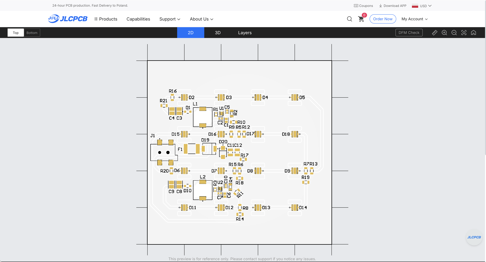  
  
  
  
## Received boards  
  
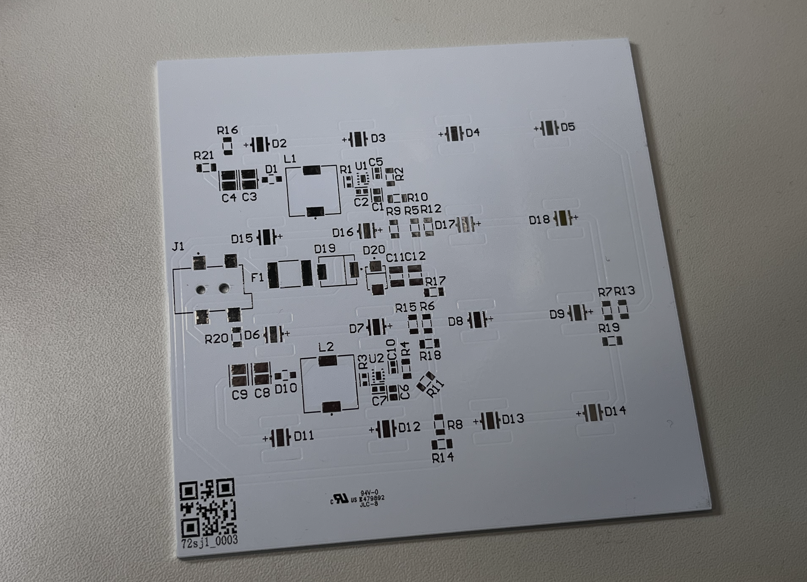  
  
  
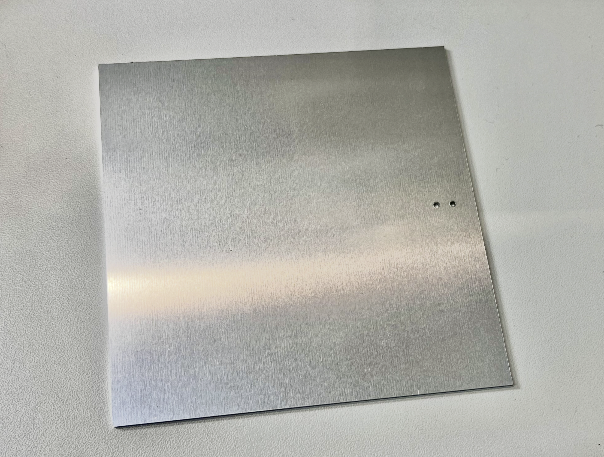  
  
## Hand assembly  
  
Boards hand assembled. Used super low cost 3D printed stencil, designed in FreeCAD.   
  
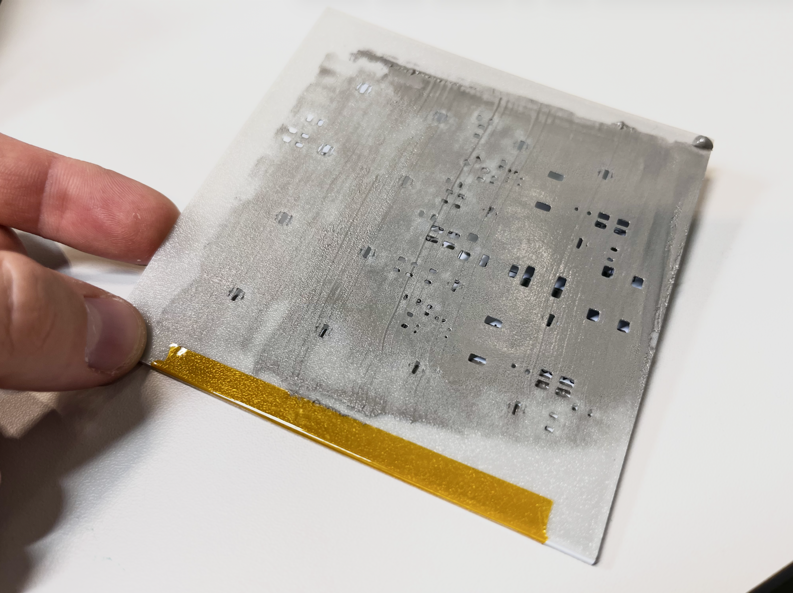  
  
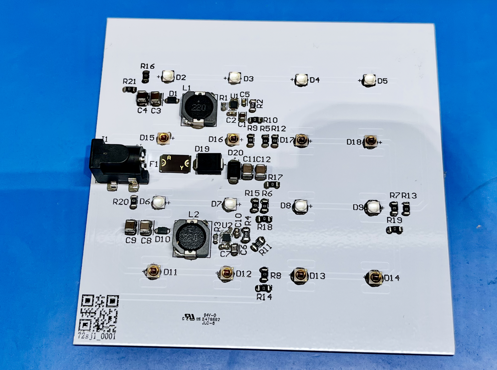  
  
Soldered in a reflow oven  
  
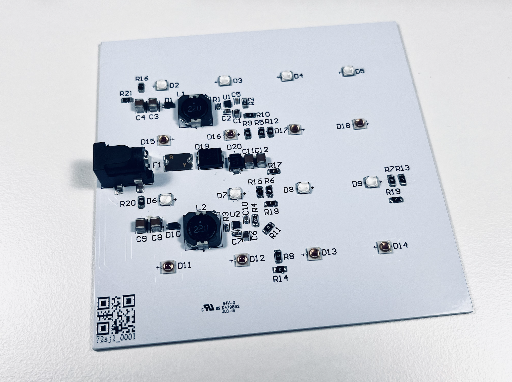  
  
  
## Bringup and testing  
  
There is not much for the bringup - check for shorts and connecting straight to the power supply. And it works.  
  
  
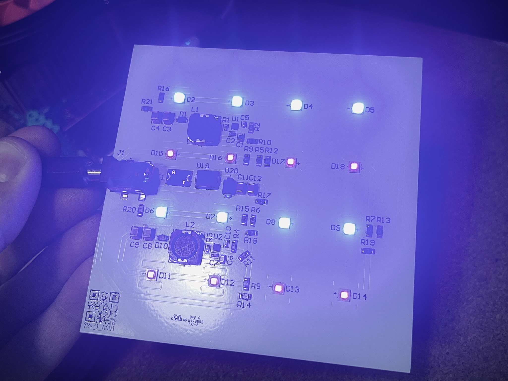  
  
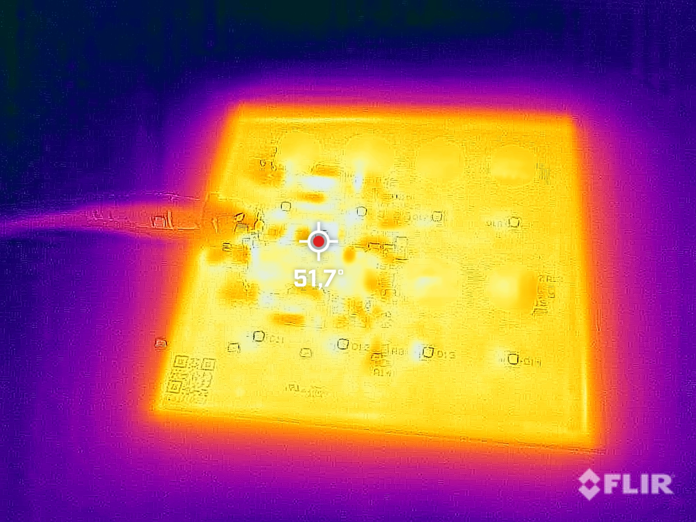  
  
  
## Summary  
  
It is not a rocket science. Simple board. It works.   
  
  
## References   
  
1. JLCPCB – Metal Core PCB Materials: Thermal Truth & Design Rules  
https://jlcpcb.com/blog/metal-core-pcb-thermal-conductivity-design-guide  
Probably the best JLCPCB article on MCPCB design. Covers stackup, dielectric thermal resistance, aluminum vs copper cores, manufacturing limits, trace sizing and when to choose MCPCB over FR-4.  
  
2. JLCPCB Help Center – PCB Technical Guidelines  
https://jlcpcb.com/help/catalog/186-PCB-Technical-Guidelines  
Contains official manufacturing guidelines, including aluminum substrate capabilities, process limitations, panelization and DFM recommendations.  
  
3. JLCPCB – Great News! Aluminum Substrates Are Now Available  
https://jlcpcb.com/news/new-arrival-aluminum-pcb-boards  
Official capabilities document. Includes supported board thicknesses, minimum drill and trace/space, routing limitations, V-cut recommendations, why through-hole parts are discouraged, and panelization recommendations.  
  
4. Altium – Why and How to Use an Aluminum PCB Substrate for Your Next Stackup Design  
https://resources.altium.com/p/why-and-how-use-aluminum-pcb-substrate-your-next-design  
One of the best introductions to aluminum-core PCBs. Explains stackups, dielectric layers, thermal management, via considerations, applications, and trade-offs between FR-4 and MCPCB.  
  
5. LeitOn – Aluminium PCB Design Guidelines (IMS / MCPCB)  
https://www.leiton.de/technology-alu-printed-circuits.html  
Excellent reference for design rules, stackups, copper thickness, dielectric options, and manufacturing limits.  
  
6. TSPCB – Aluminium Core PCBs: Parameters, Applications and Design  
https://tspcb.pl/en/knowledge-centre/compendium/quality/aluminium-core-pcbs-parameters-applications-and-design/  
Good explanation of thermal conductivity, IMS construction, applications, and design trade-offs.  
  
7. Aivon – IMS PCB Layout Guidelines: Designing for Optimal Thermal Management  
https://www.aivon.com/blog/pcb-design/ims-pcb-layout-guidelines-designing-for-optimal-thermal-management/  
Focused on PCB layout practices, thermal management, reliability, and common design mistakes.  
  
8. HilPCB – Aluminum PCB and Metal Core PCB Selection Before Release  
https://hilpcb.com/en/blog/aluminum-metal-core-pcb-design-guide/  
Discusses when MCPCB is the correct solution versus FR-4, dielectric selection, and validation.  
  
9. HilPCB – MCPCB Material Selection and Stackup Design Guide  
https://hilpcb.com/en/blog/metal-core-basics-pcb-stackup-materials/  
Compares aluminum, copper, and IMS stackups with practical design recommendations.  
  
10. RayPCB – Aluminum PCB: Complete Guide to Structure, Types & Manufacturing  
https://www.raypcb.com/aluminum-printed-circuit-boards/  
Comprehensive overview covering board structure, dielectric materials, manufacturing, and applications.  
  
11. AtlasPCB – Aluminum PCB Thermal Design for High-Power LED  
https://www.atlaspcb.com/blog/aluminum-pcb-thermal-design-led-motor-driver/  
Excellent thermal design guide with dielectric conductivity, LED layout, and thermal calculations.  
  
12. NextPCB – Metal Core PCB (MCPCB): Comprehensive Guide  
https://www.nextpcb.com/blog/metal-core-pcb-guide  
Good introduction to MCPCB construction, material selection, and design specifications.  
  
13. JHYPCB – What is IMS PCB? A Guide to Insulated Metal Substrate PCBs  
https://www.pcbjhy.com/blog/what-is-ims-pcb/  
Solid beginner-to-intermediate overview of IMS technology and applications.  
  
14. APTPCB – Aluminum PCB Selection: Construction, Dielectric Trade-offs, and When the Metal Core Earns Its Place  
https://aptpcb.com/en/blog/aluminum-pcb-guide  
Excellent discussion of dielectric selection, thermal vs. electrical trade-offs, and design decisions.  
  
15. FastTurn PCBs – Metal Core PCB Explained  
https://www.fastturnpcbs.com/blog/metal-core-pcb/  
Covers stackups, thermal design principles, and practical applications for MCPCBs.  
  
  
  
  
  
  
  
  
  
  
